<div align="center">



<a href="https://satyam1120k.github.io/Profile/">Portfolio</a> ·
<a href="https://www.linkedin.com/in/satyam1120k/">LinkedIn</a> ·
<a href="https://leetcode.com/satyam1120k/">LeetCode</a> ·
<a href="https://codeforces.com/profile/satyam1120k">Codeforces</a>

</div>

<br>

### 📈 training log

```console
$ python train.py --model satyam --epochs ∞

Epoch 1/∞   hello world in python ........... loss: 0.92   acc: 0.31
Epoch 2/∞   C++ & the DSA grind ............. loss: 0.78   acc: 0.44
Epoch 3/∞   Python & Machin Learning ........ loss: 0.70   acc: 0.50
Epoch 4/∞   first neural network ............ loss: 0.61   acc: 0.55
Epoch 5/∞   computer vision rabbit hole ..... loss: 0.59   acc: 0.60
Epoch 6/∞   real-time pose guidance ......... loss: 0.55   acc: 0.63
Epoch 7/∞   full-stack: React + FastAPI ..... loss: 0.53   acc: 0.68
Epoch 8/∞   Langchain & Agentic AI .......... loss: 0.48   acc: 0.72
Epoch 9/∞   shipped Vantage AI & MediTrack .. loss: 0.42   acc: 0.77
Epoch 10/∞  Javascript & Game Development ... loss: 0.39   acc: 0.81
Epoch 11/∞  Kara Board Game ................. loss: 0.36   acc: 0.83
Epoch 12/∞  Greenvale ....................... loss: 0.32   acc: 0.86   ← current

⚠ early stopping disabled. model is still training.
```

### 💾 saved checkpoints

| checkpoint | what it does | stack |
|:--|:--|:--|
| [`vantage_ai.pt`](https://satyam1120k.github.io/Vantage-AI/) | AI-powered platform for practical, everyday applications | FastAPI · React |
| [`meditrack.pt`](https://satyam1120k.github.io/Meditrack_Frontend/) | A calm, simple way to keep track of health information | React · Firebase |
| [`grayscale.pt`](https://github.com/satyam1120k/grayscale) | Image processing experiments in grayscale conversion | Python · OpenCV |
| [`portfolio.pt`](https://satyam1120k.github.io/Profile/) | Where everything else lives | HTML · CSS · JS |

### 🧪 in training: pose guidance

```
prototype → playtest → observe friction → tune feel → polish
```

### 📦 dependencies


<br>

### 🔒 hidden layers

<details>
<summary><b>🧑‍💼 if you're a recruiter</b></summary>

<br>

- **who:** AI/ML developer focused on computer vision and deep learning
- **strongest at:** taking a model all the way to a real app (model → API → UI)
- **currently building:** a real-time pose guidance system (MMPose, LSTM, Kalman filter, TTS)
- **open to:** opportunities and collaborations. Say hi on [LinkedIn](https://www.linkedin.com/in/satyam1120k/)

</details>

<details>
<summary><b>👨‍💻 if you're a developer</b></summary>

<br>

My favorite rabbit holes are pose estimation, temporal models, and making models fast enough to run in real time.
Always happy to talk CV, DSA problems, or side projects. If you're building something cool, open an issue or message me.

</details>

<details>
<summary><b>🐛 known bugs</b></summary>

<br>

```
BUG-001   Obfuscating the past Actions
BUG-002   don't want to do anything
BUG-003   Want to die
BUG-004   2 AM writer
BUG-005   Single
STATUS    won't fix
```

</details>

<details>
<summary><b>🚫 do not click</b></summary>

<br>

You clicked. Of course you did.
That curiosity is the whole job. 🏆 **achievement unlocked: curious visitor** <br>
fine if you click it already then read it.
<br>

<div align="center">

### ✍️ *Uncompiled Thoughts*

*Khud hi khud me uljha kirdaar hu main,*  
*Logon ko lagta hai samajhdaar hu main.*  
*Jee chahta hai unko seene se laga kar rakhun,*  
*Magar, jo unka kabhi na ho saka, woh pyaar hu main.*

<br>

*Kahaan se laaun woh lafz jo tujhe sunayi dein,*  
*Kahaan se laaun woh naseeb jo tujhe mera bana de.*  
*Haath uthte hain har dua me bas isi talab me,*  
*Kaash koi karishma ho jo ye doori mita de.*

<br>

*Mohabbat agar lafzon me bayaan hoti toh hum kitaab likh dete,*  
*Aap muskura kar toh dekhte, hum ye jahaan aapke naam kar dete.*

</div>


</details>

<br>

<div align="center">

<picture>
  <source media="(prefers-color-scheme: dark)" srcset="https://raw.githubusercontent.com/satyam1120k/satyam1120k/output/github-contribution-grid-snake-dark.svg"/>
  <source media="(prefers-color-scheme: light)" srcset="https://raw.githubusercontent.com/satyam1120k/satyam1120k/output/github-contribution-grid-snake.svg"/>
  
</picture>

<sub>think → build → break → learn → improve</sub>

</div>
